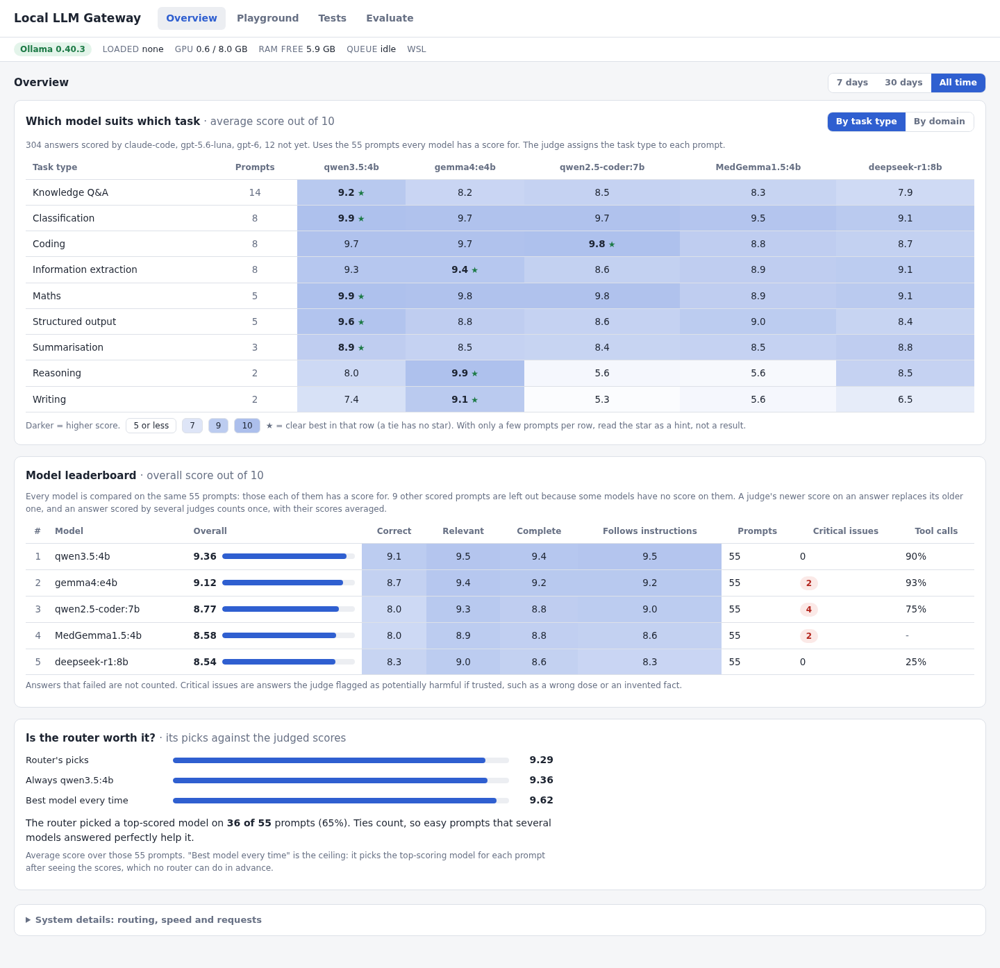
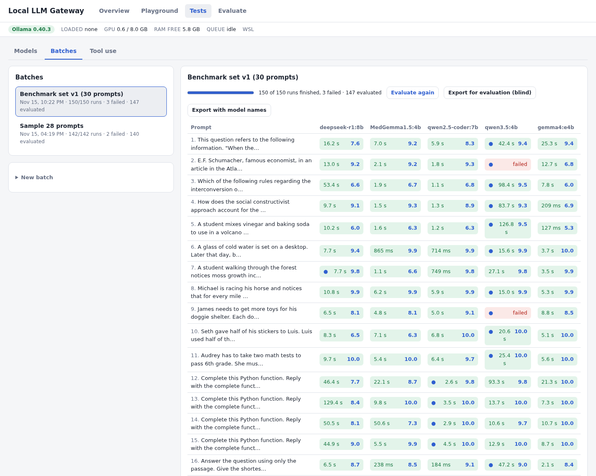
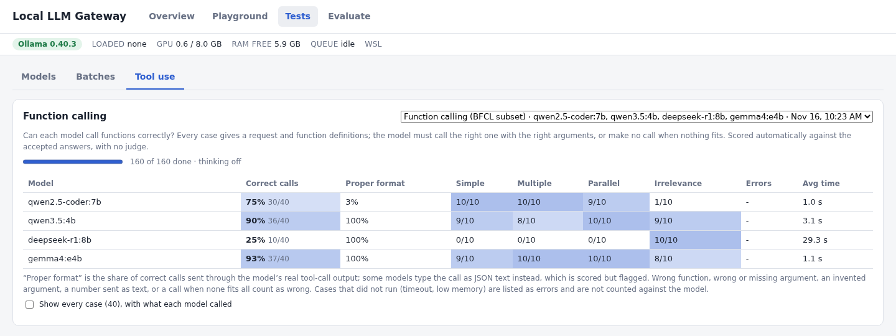
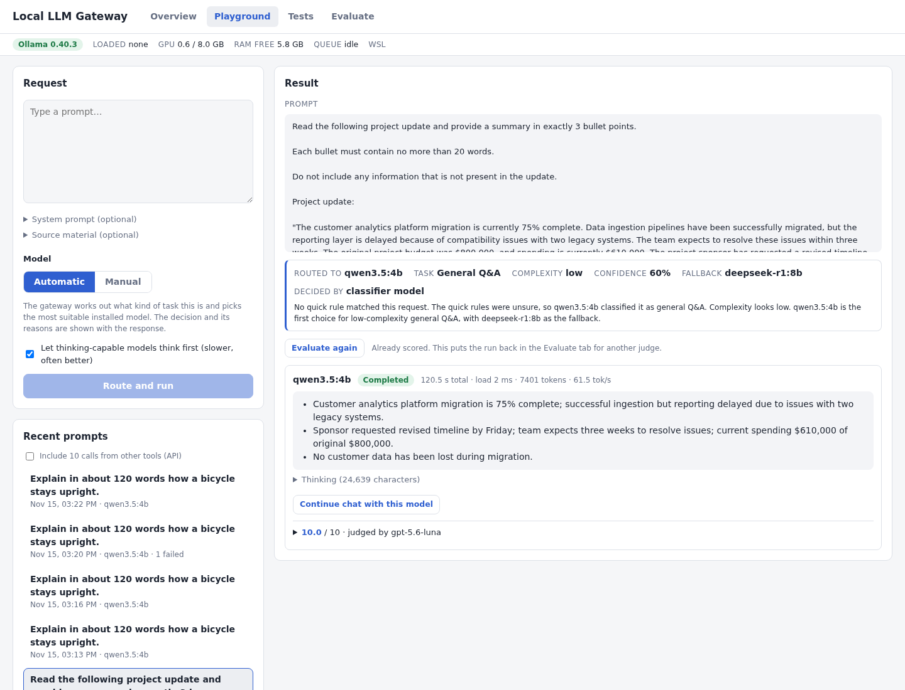

# Local LLM Gateway and Evaluation Platform

A gateway for running several local language models on one 8 GB GPU, with a router that picks a model per prompt and a way to score the answers blind and compare the models by task type.

It runs [Ollama](https://ollama.com) models, stores every prompt and answer in SQLite, and has a web UI for single prompts, side-by-side comparison, and batch runs. Evaluation is done by an external judge (Claude Code, or any chat model) against a fixed rubric, with model names hidden from the judge.

## Screenshots



*Overview: average judge score per task type, then the leaderboard (with the function-calling result), then whether the router's picks beat always using one model. All models are compared on the prompts every one of them has a score for.*



*Tests → Batches: one row per prompt, one column per model; each cell shows the run time and the judge's score. A dot marks the router's pick.*



*Tests → Tool use: 40 function-calling cases from the Berkeley Function Calling Leaderboard, scored automatically.*



*Playground: one prompt, routed automatically or run on chosen models, with earlier prompts on the left.*

## What the first test found

28 prompts run on five local models and judged blind (details and limits in [docs/RESULTS.md](docs/RESULTS.md)):

| Model | Overall (0 to 10) | Median time |
|---|---|---|
| `qwen3.5:4b` | **9.55** | 16.7 s |
| `gemma4:e4b` | 9.35 | 5.7 s |
| `deepseek-r1:8b` | 8.93 | 13.1 s |
| `MedGemma1.5:4b` | 8.81 | 2.6 s |
| `qwen2.5-coder:7b` | 8.77 | 2.0 s |

- The 4B general model beat the 7B to 8B specialists overall. A specialist led only in coding (narrowly) and reasoning (on two prompts).
- The medical model did not beat the general model on medical text (four prompts).
- With "thinking" on, one model spent its entire context window reasoning on 2 of 28 prompts and returned nothing. The app now flags this and offers a rerun without thinking.
- The router **matched the best single model (9.54 against 9.55) but did not beat it** (measured on the first four models).
- `gemma4:e4b`, added later with one click, came second at a third of the leader's time and led on reasoning, so the routing table now sends reasoning prompts to it.

**Function calling** (40 BFCL cases, scored automatically):

| Model | Correct calls | Sent as a real tool call |
|---|---|---|
| `gemma4:e4b` | **37 / 40** | all |
| `qwen3.5:4b` | 36 / 40 | all |
| `qwen2.5-coder:7b` | 30 / 40 | 1 of 30 (writes JSON text instead) |
| `deepseek-r1:8b` | 10 / 40 | never calls a tool |

This is a small, single-judge, author-written test; treat it as a worked example of the method, not a benchmark.

## Features

- **Run prompts** on one model, on several for comparison, or let the router choose.
- **Batches:** many prompts across all models, grouped by model to limit the 5 to 19 s model swaps. Interrupted batches can be resumed.
- **Blind evaluation:** export outputs without model names, have any judge score them on a five-dimension rubric, paste the JSON back. The app computes the weighted overall score so it is reproducible. A Claude Code command, `/evaluate-batch`, does the whole round trip.
- **Task labels:** the judge also labels each prompt with a task type and domain from fixed lists based on public benchmark families, so results show which model suits which kind of task.
- **Overview screen:** per-model and per-task scores (all models compared on the same prompts), function-calling results, a check of the router's picks against the judged scores, and routing and throughput details.
- **OpenAI-compatible endpoint** at `/v1` with streaming and function calling, so editors, chat apps and agent frameworks can use the local models through the router (model name `auto`).
- **Tool-use tests:** 40 function-calling cases from the Berkeley Function Calling Leaderboard (one call, choosing among functions, parallel calls, and knowing when no function fits), scored automatically with no judge.
- **Model lineup:** add a newly installed model to every existing batch and tool-use test with one click, or hide a model and its results everywhere without deleting anything.
- **Follow-up chat** from any answer, with a context-window meter.
- **Guardrails for small machines:** a memory guard (unloads the model before Ollama's prompt cache exhausts RAM), a queue that runs one generation at a time, and detection of answers lost to thinking.

## How it works

```
 Web UI ──┐
          ├─► FastAPI ─► router ─► queue (one generation at a time) ─► Ollama ─► models
 /v1 API ─┘      │
                 └──────► SQLite: requests, answers, routing decisions, scores
```

Requests return at once and run in the background; the UI shows the text as it is generated. Everything is stored whether or not it is ever evaluated.

### The router

1. **Quick rules, no model.** 23 weighted pattern rules (each a regular expression over many keywords) vote for one of seven categories (general Q&A, classification, extraction, structured output, reasoning, coding, medical). A clarity score says how decisively one category won, and a separate set of cues estimates complexity.
2. **A small classifier model, only when the rules are unsure.** If clarity is low *and* the two leading categories would lead to different models, `qwen3.5:4b` is asked for a category (thinking off, JSON output only, first 2,000 characters of the prompt). This was needed for 4 of 28 prompts in the test above. It never answers the prompt. `GATEWAY_ROUTER_LLM=off` turns it off.
3. **A readable table, no model.** [`config/models.yaml`](config/models.yaml) maps each category to an ordered list of models. Equals are broken by which model is already loaded on the GPU. This table is hand-written; it is not learned from the scores, and the results show it is the weakest part (it favours the medical model for medical text).
4. **Confidence is a formula** based on how the decision was reached, not a model's self-report. It is not calibrated.

On 25 labelled prompts the rules were never tuned against, the full router found the right category for 20 and chose the intended model for 23.

### Evaluation

The rubric is in [`config/rubric.yaml`](config/rubric.yaml) and the judge instructions in [`config/judge_prompt.md`](config/judge_prompt.md); both are versioned and recorded with every score. Judging is blind: names are removed and outputs are ordered by a random id. An in-app judge that calls the Claude API is planned but not built; today the judge is whichever chat model or Claude Code session you give the export to.

## Quick start

Needs Linux or WSL2 (developed and tested on WSL2 Ubuntu; other systems untested), [Ollama](https://ollama.com) running, [uv](https://docs.astral.sh/uv/), and Node 20.19 or newer. An NVIDIA GPU is optional but makes it practical.

```bash
# 1. Install the models named in config/models.yaml (any subset works)
ollama pull qwen3.5:4b          # repeat for the others you want

# 2. Build the UI and start the app
cd frontend && npm ci && npm run build
cd ../backend && uv sync && uv run uvicorn llm_gateway.main:app
```

Open http://localhost:8000. Settings go in a `.env` file (copy [`.env.example`](.env.example)); every one is optional.

Use it from other tools:

```bash
curl http://localhost:8000/v1/chat/completions -H "Content-Type: application/json" -d '{
  "model": "auto",
  "messages": [{"role": "user", "content": "Write a Python function that reverses a string."}]
}'
```

[docs/USAGE.md](docs/USAGE.md) covers every screen, the memory guard, resuming batches and the endpoint in detail.

## Tests

```bash
cd backend && uv run pytest        # 174 tests, no Ollama or GPU needed
cd backend && uv run pytest -m live   # against real Ollama; loads a model
```

The tests run against a fake model provider. CI runs lint, the backend tests and the frontend build on every push.

## Repository layout

```
backend/src/llm_gateway/   API, runner, queue, SQLite store, routing/, evaluation, OpenAI endpoint
backend/tests/             unit and API tests with a fake provider
backend/scripts/           swap-time measurement, router reports, command-line evaluation tools
config/                    models.yaml (routing table), rubric.yaml, judge_prompt.md, tool_suites/
frontend/src/              React UI (Overview, Playground, Tests, Evaluate)
docs/                      USAGE, ARCHITECTURE, RESULTS, SWAP_TIMES, sample prompts
.claude/commands/          /evaluate-batch for Claude Code
```

## Limitations

- Tested only on one machine (RTX 4060 8 GB, WSL2 with 6 to 9 GB RAM) and with five models.
- One generation runs at a time, because the GPU holds one model. A batch and an editor assistant share the queue.
- The `/v1` endpoint does not support images and has no authentication; it is meant for `localhost`.
- Results rest on 28 prompts and one judge. Judge agreement and human spot checks have not been done.
- The in-app Claude API judge, human review of scores and a learned routing policy are not built.

## Documentation

- [docs/USAGE.md](docs/USAGE.md): running and using the app
- [docs/RESULTS.md](docs/RESULTS.md): the test above, with method and limits
- [docs/ARCHITECTURE.md](docs/ARCHITECTURE.md): design decisions and the reasons for them
- [docs/SWAP_TIMES.md](docs/SWAP_TIMES.md): measured model load times
- [DEVELOPMENT_PLAN.md](DEVELOPMENT_PLAN.md): the original requirements

## License

[MIT](LICENSE)
